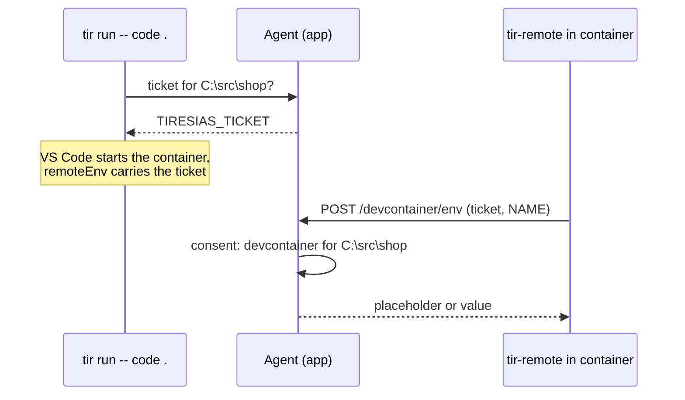

# Devcontainers that ask instead of carrying

Status: **design**. Phase 6 of [containers and VMs](containers-and-vms.md), issue #113. Its threat
entry is [S-devcontainer-ask](threats/S-devcontainer-ask.md).

## The problem

Phase 2's fix for a devcontainer that holds secrets moves the value from `containerEnv` to
`remoteEnv` as `"${localEnv:NAME}"` and starts VS Code with `tir run -- code .`. That takes the
value out of the project file and the engine's view of the container, but it still lands in every
process VS Code starts in the container, for as long as the container runs, with one consent at
start for all of it. Git credentials and registry logins come in another way: VS Code forwards
the host's credential helper, so anything in the container can ask the host for any of them, with
no consent at all.

A devcontainer should start with no secrets, and a tool in it should ask when it needs one, with
the consent dialog saying which devcontainer asks.

## Decisions

| Question | Decision |
|---|---|
| How the container reaches the host | Through **Docker Desktop's `host.docker.internal`**, which relays to the host's loopback. Nothing of Tiresias listens beyond loopback |
| Who the host thinks is asking | Docker Desktop's backend process opens every relayed connection, so the host can't tell one container, or one process, from another. A **ticket** names the devcontainer instead |
| Where a ticket comes from | `tir run -- code <folder>`, when the folder's `devcontainer.json` has `"TIRESIAS_TICKET": "${localEnv:TIRESIAS_TICKET}"` in `remoteEnv`. One ticket per folder, held in the agent's memory only |
| What a ticket lets a container do | Ask the agent for sealed variables and git credentials, each through the consent dialog. It opens nothing by itself |
| What consent shows | "*Devcontainer for C:\src\shop* wants `OPENAI_API_KEY`". Never a process: the host can't see one |
| What the container gets | A placeholder where the variable has placeholder delivery, otherwise the value. **Allow once** is the default; **Allow for this container** lasts until the ticket ends |
| How long a ticket lasts | Until Tiresias locks, or 10 hours, whichever comes first. Not tied to the `code` process, which exits as soon as it hands the folder to VS Code |
| What runs in the container | `tir-remote`, a small static Linux binary with `run`, `env` and `git-credential`, installed by a devcontainer feature. It holds no key and stores nothing |
| Docker without Docker Desktop | Not supported: there is no `host.docker.internal` relay to loopback. `tir doctor` says so for such a folder |

## Design twice: the way in

| | Docker Desktop's relay to loopback (chosen) | A listener on the Docker network |
|---|---|---|
| Shape | The agent listens on `127.0.0.1:7782`. The container calls `http://host.docker.internal:7782`; Docker Desktop's backend relays it to the host's loopback | The agent listens on the host's address on Docker's or WSL's virtual network, and the container calls that address |
| New exposure | None beyond today: any container can already reach host loopback services through the relay, and every one gets the same refusal without a ticket | A listener off loopback, reachable from every VM and container on that network, and from the LAN if the address or firewall is ever wrong. `LoopbackGuard`'s rule ("anything that isn't loopback is refused") would need an exception |
| Who is calling | The backend process, for every container | A container's address, which Docker reuses and the container can't be trusted about either |
| Works with | Docker Desktop only | Any engine, once each one's network is found |

The relay wins: the host's only listeners stay on loopback, and neither design can name a
container without a ticket anyway. Engines without Docker Desktop are rare on Windows workstations
and can be added later the second way, with its own threat entry.

A third way, VS Code's own channel to the container (what its credential forwarding uses), was
dropped: it works only in VS Code, through an extension Tiresias would have to ship and trust.

## Shape

- **`tir run`** mints a ticket only when the folder it runs in (or `code`'s folder argument) has a
  `devcontainer.json` asking for one, and only once a consent dialog says "*Start VS Code with a
  ticket for C:\src\shop*". A second `tir run` for the same folder gets the same ticket.
- **The endpoint** is part of the agent (the app, or `tir agent`), not the forwarder: the
  forwarder relays to a broker, has no path to the agent, and doesn't run in solo mode. It accepts
  `POST /devcontainer/env` and `POST /devcontainer/git` only, with
  `Authorization: Tiresias <ticket>`. A request without a known ticket is refused before its body
  is read, and the refusal is logged without the ticket.
- **`tir-remote run [--only NAME,...] -- <command>`** asks for the folder's variables (as
  `tir run` does on the host), then runs the command with them. `tir-remote env NAME` prints one
  placeholder or value, for tools that take it on stdin.
- **`tir-remote git-credential get`** is a git credential helper. It asks for a host's token from
  a sealed variable mapped to that host (as `tir env nuget add` maps a feed). The fix for phase 2's
  *Credential forwarding* finding then becomes: turn VS Code's forwarding off, and add the feature.
- **The feature** (`ghcr.io/hansen-consultancy/devcontainer-features/tiresias`) installs
  `tir-remote` and sets git's `credential.helper`. It is versioned with Tiresias and its binary
  checked against the release's checksum at install.

## Consent

The dialog names the devcontainer's folder, the variable, and whether it goes out as a value or a
placeholder. It can't name a process, and says so ("a program in this devcontainer"). **Allow
once** is the default button. **Allow for this container** remembers the folder and variable until
the ticket ends; it is never remembered per image. Locking ends every ticket, and with it every
allowance.

## Honest limits

- Anything in the container that can read `TIRESIAS_TICKET` (any process VS Code started there)
  can ask with it. Consent is the only check between a tool and a malicious package in the same
  container, and it can't tell them apart.
- A value, once given, is in that process and its children until they exit. Placeholder delivery
  is the answer where a tool allows it.
- A program running as you on the host can mint a ticket with `tir run` as you do; it gains nothing
  it couldn't take from the host's own consent. Its consent dialog still names the folder.
- Every container can reach the endpoint through the relay. Without a ticket it gets only a
  refusal; tickets are 256 random bits.

## Tests

- the ticket rule: a folder whose `devcontainer.json` doesn't ask for one gets none; the same
  folder gets the same ticket; a lock ends them all (pure planner, like `EnvironmentDelivery`);
- the endpoint refuses a missing, unknown or ended ticket before reading the body, and never
  writes a ticket to the activity log;
- consent text names the folder and never a process;
- `tir-remote`'s request and reply are Protocol records, versioned, with round-trip tests.

## Phases

- **6a. Validate the relay.** On a machine with Docker Desktop, with the owner's OK: a container
  reaching a test listener on `127.0.0.1` through `host.docker.internal`, and which process the
  host's TCP table names for it. Nothing else is built until this holds. **Done** (Docker Desktop
  4.96, WSL 2 backend): a `node:24-slim` container's `fetch('http://host.docker.internal:7799/')`
  reached a listener bound to `127.0.0.1:7799` only, and the TCP table named the connection's
  owner `com.docker.backend.exe`, not anything in the container.
- **6b. Tickets, the endpoint and `tir-remote run`/`env`.** Placeholders and values on request,
  with consent naming the devcontainer.
- **6c. Git credentials and the feature.** `git-credential`, the published feature, and phase 2's
  forwarding finding pointing at it.
