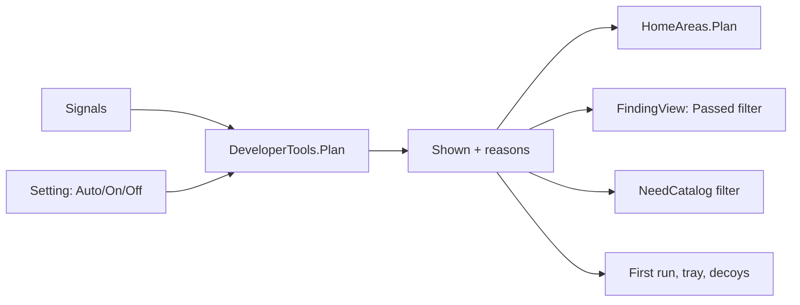

# Developer tools appear when the machine is a developer's

Status: **design**, issue #141. Builds on [what is in use](what-do-you-need.md#phase-4-what-is-in-use).

## The problem

Tiresias started as a developer tool, and grew decoys, the Installed page, alerts and the admin
tier, which are for anyone. Someone who isn't a developer still meets developer words:

- Passed lists `docker engine`, `wsl disks`, `hyper-v`, `git credentials` and `user secrets`
  lines on a PC with none of those.
- *What do you need?* offers databases, git, publishing keys and CLI sign-in.
- First run asks for a Mode: Solo, Broker or Secrets only.
- The Decoys card offers a *Project* decoy, and solo mode warns about egress and isolation.

Home already lists an area only when it is in use (`HomeAreas.Plan`), so the nav itself is
mostly quiet for this user. What is still loud is the developer **checks**, **needs** and
**hints**, and none of them can tell a developer's PC from anyone else's.

## Decisions

| Question | Decision |
|---|---|
| A mode to choose? | **No.** No Basic/Advanced switch and no first-run question. Most people can't answer one, and the PC already knows |
| What decides | **Developer signals** (below), read without admin rights while locked. Any one signal shows the developer tools |
| What shows for everyone | Home: lock state, findings, the Decoys card, the Reach card when it applies. Installed, About (Alerts, the admin tier card), and Activity when it has records |
| What shows only with developer tools on | Developer *discovery*: User secrets, Services and Environment variables in the nav before they are in use; developer needs in *What do you need?*; `tir` hints; the Passed lines of developer checks; first run's Mode step; the Project decoy; the solo egress and isolation warnings |
| What never hides | **A finding, and an area in use.** Developer checks always run. A Warn or Fail line always shows, and is itself a signal (a plaintext `secrets.json` means user secrets are in use). The [in-use rules](what-do-you-need.md#phase-4-what-is-in-use) stay as they are; developer tools only *add* areas |
| The override | One setting in About, **Show developer tools**: Auto (the default), On or Off. Kept in `app.json` |
| Saying why | When Auto first turns them on, Home shows one line: "Developer tools are shown because the .NET SDK is installed." It has a **Change...** link to About and closes for good with ×. About repeats the reason beside the setting |
| `tir` | Unchanged. It still installs and goes on `PATH`. `tir doctor` prints every line: whoever runs it is a developer |
| Consent history | There is no separate screen: Activity is the history, and it is for everyone |

### Off never hides what you use

**Off** removes the developer discovery listed above. It doesn't remove an area that is in use,
a finding, or a fix's window: those come from the in-use rules, which Off doesn't touch. A
developer who chooses Off and seals a variable later sees Environment variables, because it is
now in use. That way Off can't hide a risk, and it needs no warning. An Off that also hid areas in use was
considered and rejected: it would hide a sealed variable's only editor.

## Audit

Tags: **E** everyone, **D** developer, **A** admin tier, **T** Tiresias's own health. Today means
how the surface is gated now; Proposed means how this design gates it.

### Navigation, windows, tray

| Surface | Today | Tag | Proposed |
|---|---|---|---|
| Home | always | E | — |
| User secrets | in use | D | in use, or developer tools on |
| Services (HTTP, SQL Server, RavenDB) | in use | D ⚠ | in use, or developer tools on |
| Environment variables | in use | D ⚠ | in use, or developer tools on |
| Activity | has records | E | — |
| Installed | always | E | — |
| About: start with Windows, build, data folder | always | E | — |
| About: Alerts card | always | E | — |
| About: Admin tier card | always | A | — (offered to everyone; see [edge cases](#edge-cases)) |
| Activity: Incidents button, `ServiceIncidentsWindow` | admin tier installed | A | — |
| *What do you need?* | always | E | developer needs filtered (below) |
| `SqlServerWindow`, `RavenServerWindow`, `UsageWindow` | from Services or a fix | D | — |
| `ConsentWindow`, `IncidentWindow`, `AskWindow`, `ProblemWindow`, `UpdateWindow`, `RecoveryWindow` | on demand | E | — |
| `AlertSinkWindow` | from About | E | — |
| First run: Welcome, Hello, recovery key, admin tier, Done | first start | E | — |
| First run: **Mode** (Solo / Broker / Secrets only) | first start | D ⚠ | developer tools on; otherwise Solo, without asking |
| Tray: lock, Status, Add, Update, Quit | always | E | — |
| Tray: Activity | has records | E | — |
| Tray: solo mode line | solo | T | developer tools on |
| Flyout: lock card, findings, Add, Open, Update, Quit | always | E | — |
| Flyout: User secrets | in use | D | — (in use already implies it) |

### Home

| Section | Today | Tag | Proposed |
|---|---|---|---|
| Lock header, Add... | always | E | — |
| Restore card | sealed secrets Hello can't open | T | — |
| Blocked programs | a block exists | E | — |
| Reach card (containers, WSL, VMs) | a reach line ran | D | — (it only appears when a line applies) |
| Decoys card | always | E | the *Project* kind only with developer tools on |
| Findings | any | E/D | — (never hidden) |
| Checks (warn/fail, not findings) | any | mixed | — (never hidden) |
| Passed | toggled | mixed | developer lines only with developer tools on |
| Developer tools line | — | new | when Auto first turns them on, until closed |

### Checks

A check's audience is new metadata on the check (below). Findings and Warn/Fail lines are never
filtered, so the tag only decides whether an **Ok** line shows in Passed.

| Check | Tag |
|---|---|
| broker pinned, device key, recovery key, vault, trust chain, broker process, broker reachable, forwarder | T |
| mode, egress, isolation (solo) | T, shown as D ⚠ (Warn, but not a finding; see below) |
| decoys, decoy uses and reads | E |
| alerts not arriving | E |
| admin tier, decoy incident history | A |
| environment variables (secret-looking user variables) | E ⚠ |
| user secrets, project, connection string, certificate, devcontainer, devcontainer forwarding | D |
| git remote, git URL rewrite, git credentials | D |
| NuGet feed, NuGet push key, npm token, PyPI password | D |
| RavenDB certificate, RavenDB clearance, sealed key handed out as a value | D |
| gh signed in, az signed in | D |
| docker engine, wsl disks, hyper-v; docker, WSL and Hyper-V contents (opt-in) | D |
| extensions in VS Code and its forks | D |
| blocked program still present, unsigned or unused at log-on, uninstall entries, unused programs | E |

### What do you need?

| Need | Tag |
|---|---|
| api-key (placeholder, sealed, the service's identity) | E ⚠ |
| database, cli-key, cli-sign-in, project-secrets, publish, git | D |

A free-text search that matches a developer need still finds it, with developer tools off. Typing
"nuget" is a signal on its own: the user asked.

### Ambiguous (⚠), with the call made

- **Services and Environment variables.** Placeholders for an AI key are useful to anyone who pastes
  an API key into a tool. But reaching that takes `tir run`, which is a terminal. Tagged **D**.
  The *api-key* need stays **E**, because its first option is a guide, and choosing a sealed or
  placeholder option counts as opening the area, as today.
- **The environment-variables check.** Any user can have `OPENAI_API_KEY` in their environment,
  and the check is about a secret sitting where every program reads it. Tagged **E**: a Warn
  shows anyway, and its Ok line is harmless.
- **Solo egress and isolation.** They are Warn lines, but not findings: no fix, no position.
  Someone who isn't a developer can't act on them, and they never chose solo. With developer
  tools off they move to Passed as notes. This is the one place where a Warn line is quieter than
  today, chosen over keeping them as Warn for everyone.
- **First-run Mode.** Broker and Secrets only matter to a developer or a team. Without a signal,
  first run picks Solo and doesn't ask. About keeps the way to change it.
- **Installed and attack surface.** Tagged **E**. The extension findings are D, but they are
  findings, so they show whenever they fire.

## Signals

Each signal is a name or a file-existence check: no process starts, no admin rights, no value is
read. Through `UserMachine` they read the made-up machine in demo mode.

| Signal | How | Cost |
|---|---|---|
| .NET SDK | `%ProgramFiles%\dotnet\sdk` has a folder, or `HKLM\SOFTWARE\dotnet\Setup\InstalledVersions\x64\sdk` has a value (readable by users). The runtime alone, which ordinary apps install, doesn't count | 1 directory list |
| User secrets | `%APPDATA%\Microsoft\UserSecrets` has a folder (`UserMachine.UserSecretsRoot`) | 1 directory list |
| git | `git.exe` on `PATH`, or `~/.gitconfig` exists | `PATH` scan, 1 file |
| Visual Studio | `%ProgramFiles(x86)%\Microsoft Visual Studio\Installer\vswhere.exe` exists | 1 file |
| Rider | `%APPDATA%\JetBrains\Rider*` exists | 1 directory list |
| VS Code and forks | their extension folders (`SurfaceProbe` hosts) | 4 directories |
| WSL | `HKCU\...\Lxss` has a distribution (`ReachProbe.Distributions`) | 1 registry key |
| Docker | an engine pipe exists (`ReachProbe.Engines`) | pipe list |
| Sealed variables | `EnvironmentStore.Exists` | 1 file |
| `tir` in use | an activity record whose consumer is `environment` or `nuget` (`tir run`, `tir exec`, the shell hook, the NuGet plugin) | `ActivityLog`, already read for Home |
| Vault has secrets or services | `VaultEditor` counts, already read for Home | — |
| Project folders set | `ProjectIndexStore`, already read for Home | — |

VS Code alone is a weak signal, since writers and students use it too. It still counts: showing
too much to a few people costs less than hiding tools from a developer who never finds the
setting.

**When detection runs:** with the in-use facts, on the same occasions: Home opening or being
activated, the tray menu or flyout opening, and first run's start. The signals take
milliseconds, so nothing is cached and nothing latches. Uninstalling the SDK hides the developer
tools again, unless another signal holds or a feature is in use.

## Shape

- **`DeveloperTools.Plan(facts, setting)`**, pure, in `Logic/`. It returns whether the tools show
  and which signals did it, for the Home line. Tests cover every signal, every setting, and an
  unreadable fact (which counts as present, as in `HomeAreas`).
- **`HomeAreas.Plan`** gets one more fact. User secrets, Services and Environment variables are
  listed when they are in use, *or* when developer tools show (the setting's Off removes only
  the second).
- **`DoctorCheck` gains `Audience`** (`Everyone`, `Developer`, `Admin`, `Tiresias`), set where each
  check is built in Core. A test asserts that every check name the doctor can produce has one.
  `FindingView` drops Ok lines tagged `Developer` from Passed when the tools are hidden. `tir
  doctor` ignores it.
- **`Need` gains `Developer`** in `NeedCatalog`. `NeedsWindow` lists only everyone's needs when
  the tools are hidden, and the free-text match searches all of them.
- **Strings:** the Home line, the About setting and its three options. `Strings.resx`, as usual.

## Design twice

| | Detection (chosen) | Basic/Advanced, asked at first run |
|---|---|---|
| Who decides | The PC, with an override | The user, once, before seeing anything |
| A wrong answer | Too much shown: one setting away, and the Home line says where | A developer in Basic never finds the tools; a home user in Advanced sees everything |
| Later | A developer who installs the SDK next month sees the tools that day | Stays whatever was answered |
| Cost | A dozen file checks and a tag per check and need | A setting and a first-run page, plus a tag per check and need anyway |

Both need the tags. Detection adds only the signals, and doesn't ask anything first run can't
answer.

## Edge cases

- **Secrets set up later.** Running `dotnet user-secrets` creates the UserSecrets folder: the next
  Home activation finds it, the tools appear, and the Home line says why. Sealing a file puts
  User secrets in use, as today.
- **A developer who wants it hidden.** Off. In-use areas, findings and fixes stay (see
  [Off never hides what you use](#off-never-hides-what-you-use)); Passed, needs and hints go quiet.
- **Demo mode.** The signals read through `UserMachine`, so `everyday` (a developer's laptop)
  shows the tools. A new scenario, `home`, has no signals, no projects and a vault with no
  secrets, so the everyone view can be checked and captured. HKLM and `PATH` reads take their
  values from the scenario, which gains a `developer` block (`sdk`, `git`, `visualStudio`).
- **The admin tier.** Orthogonal. Its card, incidents and the decoy enrol and thaw actions depend
  on the service, not on developer tools: a home user is exactly who it is for.
- **Managed PCs.** IT installing the SDK everywhere turns the tools on for everyone; Off fixes
  that per user. A machine-wide policy value (`HKLM\SOFTWARE\Policies\Tiresias`) is left out until
  someone asks: it is another settings source to test, and nothing manages Tiresias centrally
  yet.
- **Several Windows users on one PC.** `app.json` is per user, and most signals are per user. The
  SDK and Visual Studio are machine-wide, so they show the tools to every user of that PC.
- **Locked.** Every signal reads while locked, like the in-use facts.

## Threats

No trust boundary changes: nothing new is read beyond names and file existence, nothing listens,
and no secret moves. The risk the design has to avoid is a security tool hiding a risk, and the
rule that findings and Warn/Fail lines are never filtered rules that out. The one exception is
the solo egress and isolation notes, which can't be acted on and expose nothing. So there is no
threat entry.

## Phases

1. `Audience` on `DoctorCheck`, `Developer` on `Need`, and the test that every check and need has one.
2. `DeveloperTools.Plan`, the signals, the setting in About, the Home line, and the `home` demo
   scenario.
3. Wire up `HomeAreas`, `FindingView`, `NeedsWindow`, first run's Mode step, the Project decoy and
   the tray solo line. Update `desktop-app.md` and the CHANGELOG.
